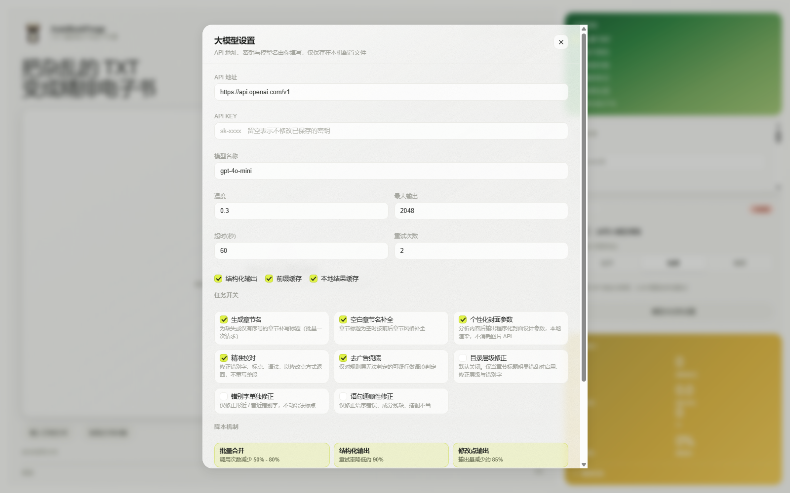

# AutoBookForge

全自动 TXT 精排电子书生产引擎。把任意格式混乱的纯文本 TXT，通过规则驱动的编码检测、文本清洗、智能分章、双层纠错、精排样式注入与封面生成，一键输出出版社级别的 EPUB / MOBI / AZW3。

**核心指标**：默认零大语言模型 API 调用，纯本地 CPU 运行，API 成本为零；另提供可选的 LLM 增强层（API 地址与密钥由使用者自行填写），用于章节命名、封面设计参数与语义级校对。

---

## 目录

- [特性](#特性)
- [安装](#安装)
- [快速开始](#快速开始)
- [Web UI](#web-ui)
- [配置驱动](#配置驱动)
- [纠错引擎](#纠错引擎)
- [LLM 增强层（可选）](#llm-增强层可选)
- [排版风格与封面](#排版风格与封面)
- [项目结构](#项目结构)
- [测试](#测试)
- [设计说明](#设计说明)
- [许可](#许可)

---

## 特性

| 能力 | 实现 | 说明 |
| --- | --- | --- |
| 编码检测 | charset-normalizer | BOM 嗅探 + 最佳猜测 + 多级 fallback（UTF-8/GBK/GB18030/BIG5/UTF-16） |
| 文本清洗 | 自研规则引擎 | 统一换行、去噪、元信息摘除、水印与段内广告清理、标题保护、智能换行合并、首行缩进硬编码 |
| 章节识别 | 自研标记族引擎 | 书内自适应多族探测 + 序号单调过滤 + 族间并集 + 邻近重复合并，卷/章/节三级，无序号文本走场景短标题兜底 |
| 元信息解析 | 自研 | 书名 / 作者 / 题材标签 / 简介自动抽取并从正文移除，写入 EPUB 元信息 |
| 质量自检 | 自研 | 章长分布、正文覆盖率、序号单调率，异常自动告警 |
| 规则层纠错 | 自研规则引擎 | JSON 规则库 + 混淆集，同音错别字/标点误用/搭配不当/重复字词 |
| 统计层纠错 | 自研轻量 NGram | 混淆集候选生成 + 词表打分，CPU 秒级，无需模型权重 |
| 精排排版 | 自研 CSS 注入 | 简约/文艺/商务/古籍 四套风格，规避 Kindle text-indent 覆盖 |
| EPUB 生成 | EbookLib | EPUB3，嵌套目录，封面，结构自检 |
| MOBI/AZW3 | Calibre ebook-convert | 可选，未安装时优雅降级 |
| 封面生成 | Pillow 直绘 | 6 套配色，9:16 竖版 1600x2560，零浏览器依赖 |
| CLI | Typer | convert / info / watch / serve 子命令 |
| Web UI | FastAPI + 原生前端 | 拖拽上传、六步导航、左右分栏 diff、进度轮询 |
| 自动化 | watchdog | 目录监听，批量处理 |
| LLM 增强（可选） | OpenAI 兼容客户端 | 章节命名、封面设计参数、语义级校对、去广告语境判定；批量合并 / 摘要输入 / 修改点输出 / 规则前置 / 前缀缓存六项降本机制 |

---

## 安装

```bash
# 创建虚拟环境（推荐）
python -m venv .venv
# Windows
.venv\Scripts\activate
# macOS / Linux
source .venv/bin/activate

# 安装依赖
pip install -r requirements.txt

# 以可编辑模式安装本包（获得 autobookforge 命令）
pip install -e .
```

可选依赖：

```bash
# MOBI / AZW3 转换需要 Calibre
#   Windows: https://calibre-ebook.com/download
#   macOS:   brew install calibre
#   Ubuntu:  sudo apt install calibre
```

---

## 快速开始

```bash
# 基础用法：TXT 转 EPUB（文艺风格，双层纠错）
autobookforge convert novel.txt -o ./output

# 指定风格与纠错档位
autobookforge convert novel.txt -o ./output --style 古籍 --correct-level 1

# 多格式输出
autobookforge convert novel.txt -o ./output --format epub,mobi,azw3

# 生成纠错报告（JSON + Markdown）
autobookforge convert novel.txt -o ./output --report

# 查看环境信息
autobookforge info

# 监听目录，自动处理新文件
autobookforge watch ./novels -o ./output
```

参数说明：

| 参数 | 默认 | 说明 |
| --- | --- | --- |
| `input_file` | 必填 | 输入 TXT 文件路径 |
| `--output, -o` | `./output` | 输出目录 |
| `--format, -f` | `epub` | 输出格式，逗号分隔 |
| `--style, -s` | `literary` | 排版风格：minimal/literary/business/classic（亦可用中文名） |
| `--correct-level, -c` | `2` | 纠错强度：1=仅规则，2=规则+统计 |
| `--cover / --no-cover` | 生成 | 是否生成封面 |
| `--cover-style` | `auto` | 封面配色：auto/minimal/literary/business/classic/tech/design |
| `--title / --author` | 自动推断 | 书名 / 作者 |
| `--report` | 关闭 | 输出纠错报告 |
| `--llm / --no-llm` | 关闭 | 启用 LLM 增强（需先填写 API 地址与密钥） |
| `--llm-budget` | `standard` | Token 预算档位：economy / standard / fine |
| `--llm-thinking` | `auto` | 推理型模型思考开关：auto / off_all / off_vllm / off_openai / off_reasoning |
| `--llm-max-chunks` | `400` | 单次校对最多送检的文本块数 |
| `--llm-task` | 无 | 临时开关任务，逗号分隔，`!` 前缀表示关闭 |

---

## Web UI

```bash
autobookforge serve --host 127.0.0.1 --port 8000
```

浏览器打开 `http://127.0.0.1:8000`。界面包含：

- 左侧：拖拽上传区、章节预览、纠错左右分栏对比、封面成品、产出文件下载
- 右侧：六步流程导航、快速设置（书名/作者/风格/纠错档位/输出格式/封面）、处理进度、统计磁贴

REST API：

| 方法 | 路径 | 说明 |
| --- | --- | --- |
| GET | `/api/health` | 健康检查 |
| GET | `/api/config` | 当前配置、可用风格、Calibre 状态 |
| POST | `/api/upload` | 上传 TXT 并创建任务（multipart） |
| POST | `/api/convert-local` | 处理本机已有文件（JSON） |
| POST | `/api/preview-correct` | 文本纠错预览，返回 diff 分段 |
| GET | `/api/jobs` | 任务列表 |
| GET | `/api/jobs/{id}` | 任务状态与进度 |
| GET | `/api/jobs/{id}/report` | 纠错报告（`?format=md` 返回 Markdown） |
| GET | `/api/jobs/{id}/download` | 下载产物（`?fmt=epub`） |
| GET | `/api/jobs/{id}/cover` | 下载封面 |

---

## 配置驱动

全部处理行为由 `configs/pipeline.yaml` 参数化，改配置无需改代码。

```yaml
steps:
  - name: text_clean
    options:
      smart_linebreak: true
      paragraph_indent: true
      remove_ads: true
      ad_config: ""            # 留空则用 configs/ad_patterns.yaml

  - name: chapter_split
    options:
      min_chapter_length: 100
      max_chapter_length: 50000

  - name: correct
    layers:
      - name: rule
        enabled: true
      - name: ngram
        enabled: true      # 设为 false 则跳过统计层

  - name: typeset
    style: literary
```

章节标记族见 `configs/chapter_patterns.yaml`，站点水印与广告字典见 `configs/ad_patterns.yaml`，
纠错规则见 `configs/correct_rules.yaml`。

---

## 分章策略

真实 TXT 的章节写法高度不统一，穷举正则必然漏判。本项目改用「书内自适应标记族」：

1. **多族候选**：`第X章/回`、`Chapter N`、`《一》`、`【3】`、`1、`、站点前缀式
   （`某某小说--正章7`）、`序/尾声/番外`、`3.1` 节号，以及弱族「裸数字占一行」。
2. **族内单调过滤**：章序号必须非递减，回卷与噪声被丢弃；允许一次「编号重开」
   （目录页之后 / 分卷重编号）。
3. **族间并集 + 邻近合并**：同一章被两族重复标注时合并为一个（保留信息量更大的标题）。
4. **层级组装**：卷 / 章 / 节三级，节归属其前面的章；超长章内部用更强证据族二次切分。
5. **兜底**：全书没有任何序号标记时（评书体 / 随笔集），自适应学习短标题行的共同前缀
   作为场景标题分章。

实测：一本混用「裸数字 1–20 + 站点前缀 正章1–44」的 27 万字符小说，
从旧版「2 章」提升到 63 章；一本 21 万字符的双部小说得到 71 章且标题全部干净。

---

## 纠错引擎

双层架构，均不含神经网络模型、不调用外部 API。

### Layer 1 规则层

JSON 规则库驱动，毫秒级完成常见中文拼写与搭配纠错。覆盖类别：

- `homophone` 同音错别字（做为 -> 作为、按耐不住 -> 按捺不住）
- `punctuation` 标点误用（连续逗号、半角转全角、省略号归一）
- `collocation` 搭配不当（增加水平 -> 提高水平）
- `duplication` 重复字词（的的 -> 的）

自定义规则：在 `configs/correct_rules.yaml` 的 `custom_rule_files` 中追加 JSON 文件路径。

### Layer 2 统计层

以「混淆集候选生成 + 词表打分」作为高精确率前置筛选：

1. 扫描 2-4 字窗口，跳过已在词表中的词；
2. 对含混淆字的窗口生成替换变体；
3. 变体命中词表则评分，超过阈值才输出修正。

接口与 pycorrector 的 `KenlmCorrector` 同构，后续可无损替换为真实 KenLM 模型。

### 可追溯性

每条修正记录包含：字符位置、原文、修正结果、来源层级（`rule` / `ngram`）、错误类别、置信度、说明。可导出 JSON / Markdown 报告，Web UI 中以左右分栏 diff 高亮展示。

### 纠错档位

| 档位 | 组成 | 速度 |
| --- | --- | --- |
| `--correct-level 1` | 仅规则层 | 毫秒级 |
| `--correct-level 2` | 规则层 + 统计层 | 秒级 |

---

## LLM 增强层（可选）

基础链路完全不依赖大模型。若希望进一步提升章节命名、封面设计与语义级校对的水平，可启用可选的 LLM 增强层：**API 地址、API Key、模型名称全部由使用者自行填写**（Web UI 的「LLM 增强 → 模型与任务设置」，或直接编辑 `configs/llm.yaml`）。未配置时整层静默跳过，基础链路不受影响。

### 七项任务

| 任务 | 说明 | 默认 |
| --- | --- | --- |
| 生成章节名 | 为空标题或仅有序号的章节补写标题（8-15 字，风格对齐全书） | 开 |
| 空白章节名补全 | 按前后章节风格补全空标题；正文不足 200 字直接用「第X章」兜底 | 开 |
| 个性化封面参数 | 输出程序化设计参数（背景 / 字体 / 装饰 / 版面），本地渲染，不消耗图片 API | 开 |
| 精准校对 | 错别字 + 标点 + 语法，以修改点方式返回（已覆盖第六、七项能力） | 开 |
| 去广告兜底 | 仅对规则层无法判定的可疑行做语境判定 | 开 |
| 目录层级修正 | 仅在章节标题明显错乱时启用 | 关 |
| 错别字 / 通顺性单独修正 | 关闭精准校对时单独运行的精简指令 | 关 |

### 统一降本设计

| 机制 | 做法 | 实测口径 |
| --- | --- | --- |
| 规则前置 | 规则能判定的绝不送模型（广告行、已合格的章节标题） | 调用量减少 60% - 80% |
| 摘要输入 | 章节名与封面任务只发 50-100 字摘要与关键词，不发正文 | 输入量减少 95% 以上 |
| 批量合并 | 多个文本块 / 章节合并为一次请求 | 请求数减少 50% - 80% |
| 修改点输出 | 只返回修改位置与内容，不重写整段 | 输出量减少约 85% |
| 结构化输出 | 字段与取值枚举固定，校验失败用最小指令回灌修复 | 重试率接近 0 |
| 前缀缓存 | system prompt 恒为 messages 首条且字节稳定 | 命中部分成本降低 50% - 90% |

每次运行都会输出降本核算（调用次数、输入 / 输出 token、缓存命中、各机制节省比例）：CLI 在 `--llm` 运行时直接打印，Web UI 在「LLM 增强」标签页以表格展示。

### 思考模式（推理型模型）

部分推理型模型会把思考过程计入 `max_tokens`，导致答案尚未输出预算就已耗尽（表现为模型
返回空内容、`finish_reason=length`）。设置项 `thinking` 提供五种写法：

| 取值 | 说明 |
| --- | --- |
| `auto` | 不干预（默认） |
| `off_all` | 同时发送三种关闭思考的写法，不确定端点类型时先选它 |
| `off_vllm` | `chat_template_kwargs` 的 `enable_thinking=false`，适配 vLLM / Ollama / LM Studio |
| `off_openai` | 顶层 `enable_thinking=false` 与 `thinking.type=disabled`，适配 OpenAI 兼容 / Qwen |
| `off_reasoning` | `reasoning_effort=none` |

端点不认识这些字段返回 400 时，客户端会自动去掉它们重试一次。增强层连续失败会自动熔断并
跳过，基础转换仍会正常产出 EPUB。

### Token 预算档位

| 档位 | 分块字数 | 每次批量 | 重叠 | 适用文本 |
| --- | --- | --- | --- | --- |
| `economy` 经济 | 500 | 10 块 | 10% | 网文、通俗小说 |
| `standard` 标准 | 300 | 5 块 | 15% | 一般文学作品（默认） |
| `fine` 精细 | 200 | 3 块 | 20% | 严肃文学、学术文本 |

### 启用方式

```bash
# 命令行写入配置并测试连通性（密钥只写入本机 configs/llm.local.json）
autobookforge llm --base-url https://api.deepseek.com/v1 --api-key sk-xxx \
                  --model deepseek-chat --budget standard --enable --test

# 转换时启用 LLM 增强
autobookforge convert 小说.txt -o output --llm --llm-budget standard
```

也可启动 Web UI 后在右侧「LLM 增强」磁贴填写。常见端点预设（OpenAI / DeepSeek / 通义 / Kimi / 智谱 / 本地 vLLM / Ollama）见 `configs/llm.yaml`。

### 实测（22.7 万字 / 71 章）

| 项 | 结果 |
| --- | --- |
| LLM 调用次数 | 18 次（覆盖 71 章命名 + 896 个文本块校对 + 5423 行广告筛查） |
| 输入 / 输出 token | 3,924 / 1,512 |
| 批量合并节省 | 78% |
| 摘要输入节省 | 99.6% |
| 修改点输出节省 | 94.9% |
| 总耗时 | 4.14 秒（其中 LLM 相关 0.23 秒） |

规则层与统计层仍是默认路径，LLM 只补充规则无法覆盖的部分。

---

## 排版风格与封面

四套排版风格（`src/autobookforge/styles/`）：

| 风格 | 特点 |
| --- | --- |
| 简约 minimal | 无衬线、1.6 倍行距、段间距大、克制留白 |
| 文艺 literary | 衬线字体、章首装饰、花式分隔符、暖色纸张 |
| 商务 business | 紧凑排版、小字号、高信息密度、左对齐标题 |
| 古籍 classic | 楷体、仿古纸色、宽字距、繁体适配、可选竖排 |

封面：6 套配色（minimal/literary/business/classic/tech/design），1600x2560 竖版，与 Web UI 同源的视觉系统。另提供 HTML 模板（`cover/templates/`）供需要 Playwright 高保真截图时使用。

关于缩进：段首直接写入两个全角空格字符，而非依赖 CSS `text-indent`。Kindle 转码时会接管 CSS 缩进导致缩水，真实字符无法被吞掉。

---

## 项目结构

```
AutoBookForge/
├── assets/                     品牌资源（Logo）
├── configs/                    YAML 配置（流水线 / 章节正则 / 纠错规则）
├── output/                     运行产物
├── src/autobookforge/
│   ├── core/                   编码检测、清洗、分章、EPUB 生成、格式转换
│   ├── corrector/              双层纠错引擎、报告、数据（规则库/混淆集/词表）
│   ├── cover/                  封面生成器与 HTML 模板
│   ├── styles/                 四套排版 CSS + 基础样式
│   ├── llm/                    可选 LLM 增强层（客户端 / 七项任务 / 降本核算 / 设置）
│   ├── pipeline/               编排器、配置加载、缓存、目录监听
│   ├── api/                    FastAPI 服务与后台任务
│   └── cli.py                  Typer CLI 入口
├── web/                        原生前端（index.html / app.css / app.js）
├── tests/                      pytest 测试套件与样本
├── pyproject.toml
└── README.md
```

---

## 测试

```bash
python -m pytest -q
```

共 104 项测试。覆盖：编码检测（UTF-8/GBK）、清洗（广告/断行/缩进）、分章（多章/卷分组/短章合并/中文数字）、纠错（规则层/统计层/报告）、EPUB 生成与结构自检、封面六风格、端到端流水线，以及 LLM 增强层（设置读写与环境变量覆盖、预算档位切块、结构化输出校验与修复重试、前缀缓存与本地缓存、七项任务的批量合并与规则前置、程序化封面渲染）。测试样本位于 `tests/fixtures/`；LLM 相关测试使用本地 mock 端点，不需要真实 API。

---

## 设计说明

### 默认路线与可选的 LLM 增强

基础链路以规则库 + 统计层替代大模型逐字校对：云端模型逐字校对一本 10 万字小说约需 14 万 tokens，而本地规则 + 统计层在 CPU 上秒级完成，成本为零。代价是复杂语义级错误的召回率低于大模型，但网络小说这类文本的常见错误，规则层已能覆盖绝大部分。

需要更强效果时，可启用可选的 LLM 增强层（见上文）。它复用同一套规则前置与批量合并策略，把调用量压到几十次量级；规则层与统计层仍是默认路径，LLM 只补充规则无法覆盖的部分。

### 许可

- 本项目代码：MIT
- EbookLib：AGPL v3，以运行时调用方式集成（不静态捆绑）；如需完全闭源分发，`core/epub_builder.py` 为单一封装点，可替换为其他实现
- charset-normalizer：MIT
- 排版引擎为自研 CSS，未引入 Vivliostyle，规避其 AGPL 运行时依赖

---

## 界面视觉

Web UI 的视觉系统（米白纸张底、墨色文字、酸橙绿强调、玻璃拟态、噪点颗粒、平滑渐变、交错入场动效）迁移自项目内的 `heart_circulation_replica-1.html`，保持统一的风格基调。全项目不使用任何 Emoji，图标一律为内联 SVG 描边图标。

主界面（左侧主工作区 + 右侧步骤导航、快速设置、LLM 增强、处理统计）：


LLM 设置弹层（API 地址、密钥、模型名由使用者自行填写，任务开关独立控制）：




---

## 精排：字体、风格与版式

### 字体系统

字体资源放在项目根的 `ttf/` 目录。程序启动时扫描该目录、读取每款字体的 name 表得到家族名，
并合并 `configs/fonts.yaml` 里的稳定 id 与角色映射。**新增字体只需把文件丢进 `ttf/`，无需改代码。**

当前内置（全部 SIL OFL 1.1，允许嵌入与再分发）：

| id | 字体 | 角色 | 说明 |
| --- | --- | --- | --- |
| `source-han-serif` | 思源宋体 | 正文 | 传统宋体，书卷气最足 |
| `source-han-serif-bold` / `-semibold` | 思源宋体 粗 / 半粗 | 章题 | 同族字重 |
| `lxgw-neo-zhisong` | 霞鹜新致宋 | 正文 | 笔画柔和开阔 |
| `lxgw-wenkai`（+ Light / Medium / Mono） | 霞鹜文楷 | 正文 | 楷体，手写温度 |
| `chill-duan-hei-song` | 寒蝉端黑宋 Pro | 章题 | 黑宋，现代书卷气 |
| `zhuque-fangsong` | 朱雀仿宋 | 引文 / 注文 | 清瘦疏朗 |

CJK 字体不能整份嵌入（20–36 MB），构建期按**本书字符集**做子集化（fontTools），输出 woff2。
实测 22 万字书稿：思源宋体 11.09 MB → 0.35 MB。子集结果按「字体 + 字符集 + 格式」缓存到系统临时目录，
重复转换从 10 秒降到 1 秒内。装饰符号（饰条菱形、圈码、罗马数字、全角空格）已纳入字符集兜底，
不会被裁掉。

### 嵌入档位与格式

| 档位 | 内容 | 增量 |
| --- | --- | --- |
| `none` | 不嵌入，走系统回退链 | 0 |
| `body`（默认） | 只嵌正文字体 | 0.3–0.7 MB |
| `body+title` | 正文 + 章题 | 0.7–1.4 MB |
| `full` | 正文 + 章题 + 引文 + 注文 | 1.7 MB 左右 |

格式：`woff2`（体积最优，默认）/ `ttf`（兼容老 Kindle）/ `both`（CSS 双 src 回退，体积翻倍）。
嵌入总体积超过上限（默认 3 MB）时自动降级到 `body` 档，并在报告里说明。

每款字体都走**三层回退链**：内嵌字体 → 系统同风格字体 → generic 族。阅读器拒绝内嵌字体时版面不崩。
子集化不改名、只裁剪字形，符合 OFL 对保留字体名的要求；`OFL.txt` 与字体清单随书打入 `fonts/`。

### 五种排版风格

| 风格 | 正文 | 行高 | 定位 |
| --- | --- | --- | --- |
| `minimal` 简约 | 系统无衬线 | 1.68 | 报告 / 通用 |
| `literary` 文艺 | 霞鹜文楷 | 1.82 | 小说 / 散文 |
| `business` 商务 | 系统无衬线 | 1.56 | 非虚构 |
| `classic` 古籍 | 朱雀仿宋 | 1.92 | 影印感古籍 |
| `guoxue` 国学精排 | 思源宋体 | 1.80 | 纸白墨黑朱红、章节饰条、纸笺扉页 |

风格层只负责字体偏好、行高、字距、标题与颜色倾向；字体栈、颜色、间距、缩进由
`styles/_tokens.css` 的令牌层统一提供。**正文不设底色**——底色交给阅读器主题，
避免读者切到夜间模式后出现浅底黑字。

### 缩进模式

| 模式 | 实现 | 设备支持性 |
| --- | --- | --- |
| `space`（默认） | 正文写两个全角空格，CSS `text-indent: 0` | 所有阅读器一致，包括会接管 CSS 的 Kindle。代价：缩进不随字号缩放 |
| `css` | `text-indent: 2em`，正文不加字符 | 支持规范的阅读器上正确且随字号缩放；老 Kindle 可能丢失缩进 |
| `spacing` | 零缩进 + 段间距 | 西式排版，适合商务与非虚构 |

### 扉页与纹样

扉页（`title_page`）：纸笺卡片式独立页，含书名、作者、朱红细线与标识。默认开启。

纹样（`page_ornament`）三层：

- `@page` 边距框：规范的页眉写法，支持 Paged Media 的引擎会渲染，主流阅读器忽略，零成本保留；
- `chapter`（默认）：每章开头一个朱红菱形与题下细线；
- `segment`：按 650 字切出逻辑页，每段顶部一个纹样。滚动阅读节奏接近书页，
  但**切分点与阅读器真实分页不重合**——reflowable EPUB 里做不到真逐页纹样，那是固定版式的领域。

竖排（`vertical`）：`writing-mode: vertical-rl`，仅 Apple Books 等少数阅读器支持良好，
不支持的会回落到横排。

### 新增 CLI

```bash
# 列出字体库、角色映射与嵌入档位
autobookforge fonts

# 国学精排 + 嵌入正文与章题 + CSS 缩进 + 逻辑页纹样
autobookforge convert 书.txt -s guoxue --font-embed body+title --indent css --ornament segment

# 指定字体、切 ttf 格式（老 Kindle）、竖排
autobookforge convert 书.txt --font-body lxgw-wenkai --font-format ttf --vertical
```

| 参数 | 默认 | 说明 |
| --- | --- | --- |
| `--font-embed` | 配置默认 `body` | `none` / `body` / `body+title` / `full` |
| `--font-format` | `woff2` | `woff2` / `ttf` / `both` |
| `--font-body` / `--font-title` | 随风格 | 字体 id |
| `--indent` | `space` | `space` / `css` / `spacing` |
| `--ornament` | `chapter` | `none` / `chapter` / `segment` |
| `--title-page/--no-title-page` | 生成 | 扉页开关 |
| `--vertical/--no-vertical` | 横排 | 竖排开关 |

Web 界面在「快速设置」中提供同样的选项，处理完成后在元信息行展示实际生效的风格、缩进模式、
纹样模式、内嵌字体与体积增量。接口 `GET /api/fonts` 返回字体清单。
